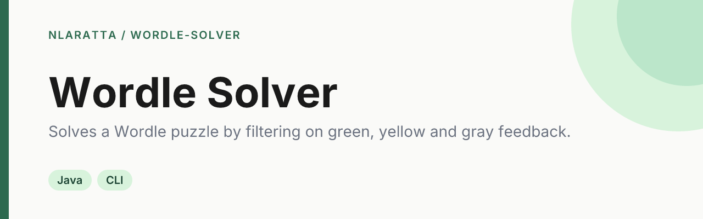

<p align="center">
  
</p>

<p align="center">
  <a href="https://github.com/nlaratta/wordle-solver/actions/workflows/ci.yml"></a>
  <a href="LICENSE"></a>
</p>

A Java Wordle solver that plays like a person: it sees only the green/yellow/gray feedback for each guess and narrows down the word list until it finds the answer.

## Quick start

Requires JDK 17+. Run everything from the repo root.

```sh
mkdir -p out && javac -d out src/*.java test/*.java   # or: make build
java -cp out WordleSolver                              # interactive menu
java -cp out WordleSolver --word crane --seed 7        # non-interactive
java -cp out FeedbackTest                              # tests (exit code 1 on failure)
```

`--word WORD` solves a specific word (exit code 0 if solved within 6 guesses, 1 if not); `--seed N` makes the random choices repeatable. The word lists are read from `data/` relative to the working directory (override with `-Dwordle.data=<dir>`).

```
Guess 1: cynic  🟩⬛🟨⬛⬛  G-Y--  (12947 candidates)
Guess 2: clown  🟩⬛⬛⬛🟨  G---Y  (52 candidates)
Guess 3: chunk  🟩⬛⬛🟩⬛  G--G-  (14 candidates)
Guess 4: crane  🟩🟩🟩🟩🟩  GGGGG  (6 candidates)
Solved in 4!
```

## How it works

- **Feedback:** each guess is scored against the answer with real Wordle rules, including duplicate letters (a repeated letter is only yellow as many times as it occurs in the answer, after greens are taken).
- **Filtering:** the solver keeps only the words that would have produced the identical feedback pattern for that guess. The answer is never inspected, only scored.
- **Guessing:** a random remaining candidate, preferring words from the official answer list. Six guesses are allowed. Over 200 random answers it solves about 97%.

The tests check feedback on tricky duplicate-letter cases, that solves end on the right word, and, over 200 seeded random answers, that "correct" is reported only when the guess equals the answer and the answer is never filtered out.

## Project structure

- `src/WordleSolver.java`: feedback, solver and CLI
- `src/Words.java`: loads the word lists
- `test/FeedbackTest.java`: self-contained tests
- `data/answers.txt`: 2,309 possible answers (the official Wordle answer list); random puzzles are drawn from here
- `data/valid-guesses.txt`: 12,947 accepted words, a superset of the answers; the solver's candidate pool and what custom words are checked against

## License

[MIT](LICENSE) © Noah Laratta
